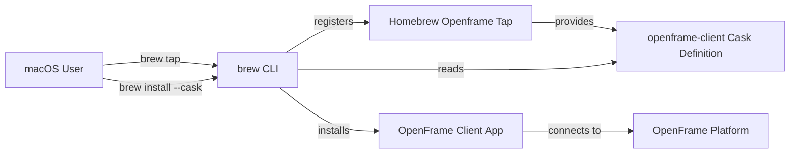

# Homebrew Openframe

The official [Homebrew](https://brew.sh) tap for the **OpenFrame Client**, part of the Flamingo AI OpenFrame platform. This repository is a Homebrew tap — a Git repository of formulas and casks that extends what `brew` can install beyond Homebrew's default collection — not an application, library, or service with its own runtime.

Its sole purpose is to let macOS users and IT administrators install, upgrade, and uninstall the OpenFrame Client using the same `brew` commands they already use for every other tool on their machine, instead of downloading a custom installer by hand.

## Features

- **Single command install** — adds the OpenFrame Client to the standard Homebrew workflow via `brew tap` and `brew install`, with no bespoke installer to learn.
- **Versioned channels** — supports installing specific release channels (stable, stage, or dev), letting teams pick the maturity level that fits their needs.
- **Straightforward upgrades and removal** — the client can be upgraded or uninstalled using familiar Homebrew cask commands (`brew upgrade --cask`, `brew uninstall --cask`).
- **Consistent with macOS tooling conventions** — fits naturally alongside other developer and IT tooling already managed through Homebrew.

## Technology stack

This repository is a Homebrew tap: it holds cask/formula definitions consumed by the `brew` CLI. It does not ship application source code, a frontend, a backend service, or a language-specific build toolchain (no `package.json`, no `pom.xml`, no lockfile). The only "runtime" involved is Homebrew itself, running on macOS.

The actual OpenFrame Client binary and the broader OpenFrame platform (including the OpenFrame CLI and the OpenFrame OSS Tenant) live in other repositories; this tap only tells Homebrew where to find and how to install that client.

## Architecture



This repository's role in the wider ecosystem graph is currently recorded as unknown, and it publishes no artifact pinned by another repository, nor does any repository appear as a recorded consumer of it. Index coverage is partial — the OpenFrame CLI and OpenFrame OSS Tenant repositories (where the actual client application and platform live) are not currently indexed, along with one further repository not visible here. An absence of recorded consumers does not mean the tap is unused; it reflects what the current index covers, not the full picture of how OpenFrame users consume it.

## Quick Start

### Prerequisites

- **macOS** with [Homebrew](https://brew.sh) installed.
- A terminal application (`Terminal.app`, `iTerm2`, etc.).

If you don't have Homebrew yet, install it from [https://brew.sh](https://brew.sh) first.

### 5-Minute Setup

Tap this repository and install the OpenFrame Client cask:

```bash
# 1. Add the flamingo-stack OpenFrame tap
brew tap flamingo-stack/openframe

# 2. Install the OpenFrame Client
brew install --cask openframe-client

# 3. Verify the tap is registered
brew tap-info flamingo-stack/openframe
```

Homebrew resolves the cask from this tap, downloads the OpenFrame Client, and installs it like any other macOS application.

Confirm the install succeeded:

```bash
# Confirm the cask is installed
brew list --cask | grep openframe-client

# Open the installed application
open -a "OpenFrame Client"
```

### Installing a specific channel

OpenFrame Client builds may be published under different channels (stable, stage, or dev). If you need a pre-release build instead of the default stable one, follow the dedicated guide: [Install a specific OpenFrame Client channel (stage or dev)](./docs/getting-started/how-to/install-a-specific-openframe-client-channel-stage-or-dev.md).

### Upgrading and uninstalling

```bash
# Upgrade to the latest version published on your tapped channel
brew upgrade --cask openframe-client

# Uninstall the OpenFrame Client
brew uninstall --cask openframe-client

# Remove the tap entirely (optional cleanup)
brew untap flamingo-stack/openframe
```

See [Upgrade or uninstall the OpenFrame Client cask](./docs/getting-started/how-to/upgrade-or-uninstall-the-openframe-client-cask.md) for full details.

## Reference

Reference documentation is being built. Check back soon.

## Getting Started

- [Introduction](./docs/getting-started/introduction.md)
- [Prerequisites](./docs/getting-started/prerequisites.md)
- [Quick Start](./docs/getting-started/quick-start.md)
- [First Steps](./docs/getting-started/first-steps.md)
- [Install the OpenFrame Client with Homebrew](./docs/getting-started/how-to/install-the-openframe-client-with-homebrew.md)
- [Install a specific OpenFrame Client channel (stage or dev)](./docs/getting-started/how-to/install-a-specific-openframe-client-channel-stage-or-dev.md)
- [Upgrade or uninstall the OpenFrame Client cask](./docs/getting-started/how-to/upgrade-or-uninstall-the-openframe-client-cask.md)

## Development

- [Development overview](./docs/development/README.md)
- [Contribution guidelines](./docs/development/contributing/guidelines.md)
- [Security practices](./docs/development/security/README.md)
- [Environment setup](./docs/development/setup/environment.md)
- [Local development guide](./docs/development/setup/local-development.md)
- [Testing guidance](./docs/development/testing/README.md)

## License

This repository is licensed under **The Flamingo AI Unified License v1.1**, copyright Flamingo AI, Inc. The license covers all Flamingo AI products, including OpenFrame, and also serves as the Terms of Use. It permits use, copying, modification, and distribution of Flamingo Software, including self-hosting, subject to copyleft and contribution-back obligations, but restricts offering the software as a competing commercial managed service without a separate commercial license from Flamingo AI. Some OpenFrame components incorporate upstream software (Fleet, Osquery, MeshCentral Agent) that remain under their own original licenses as listed in the license's Appendix. See the full text in [LICENSE.md](./LICENSE.md) for complete terms.

## Documentation

📚 See the [Documentation](./docs/README.md) for comprehensive guides.

---
<div align="center">
  Built with 💛 by the <a href="https://www.flamingo.run/about"><b>Flamingo</b></a> team
</div>
