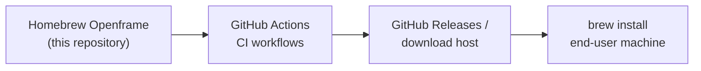

## Overview

**Homebrew Openframe** (`flamingo-stack/homebrew-openframe`) is the Homebrew tap that distributes the OpenFrame client as a macOS cask. A Homebrew tap is fundamentally different from a typical application repository: it does not run as a service, expose network endpoints, store user data, or process untrusted input at runtime in the way a backend or frontend application does. Its "attack surface" is almost entirely about the **integrity and provenance of the install pipeline** — the Ruby cask definition(s), the download URLs and checksums they reference, and the GitHub Actions workflows that build, test, and publish them.

This document adapts the standard Security tutorial topics (authentication/authorization, encryption, input validation, common vulnerabilities, security testing, and secrets management) to what actually applies to a Homebrew tap repository, and points to the organization-wide conventions that this repository's CI is held to.

> **Scope note:** The repository graph currently shows this repository with no recorded upstream dependencies or downstream consumers, and partial coverage overall (OpenFrame CLI and OpenFrame OSS Tenant are not indexed from here). Treat any "no consumers found" statement about this tap's artifacts as **inconclusive**, not as proof that nothing consumes them — end users invoking `brew install` are not visible to the code graph at all.

---

## Authentication and authorization patterns

A Homebrew tap has no application-level users, sessions, or login flow. "Authentication and authorization" here means **who can change what gets installed on a user's machine**, and that boundary is enforced entirely through GitHub's repository and Actions permissions model rather than application code:

- **Write access to `main`** is the de-facto authorization boundary: anyone who can merge into this repository controls what `brew install` delivers to every user of the tap. Treat branch protection and required reviews on this repository with the same seriousness as production deploy credentials.
- **GitHub Actions workflow permissions** are the other half of the boundary. Workflows that check out and run pull-request content (review, mining, or sweep-style jobs) must not retain a credential that could be used to push back into the repository. This is enforced as a hard rule (`OPENFRAM-010-5` / `REGISTRY-008-2`): every `actions/checkout` step in `.github/workflows/**/*.yml` must set `persist-credentials: false`, except where a workflow is explicitly exempted for legitimate publishing needs. When you add or modify a workflow file under `.github/workflows/`, check this setting first.
- **Token scope minimization**: any `GITHUB_TOKEN` or personal access token used by a workflow step (for example, to open a PR that bumps a cask version, or to publish a release) should be scoped to the minimum permission set the step needs, declared via the workflow's `permissions:` block rather than relying on default broad tokens.
- **Script provenance before trust**: where a workflow pulls in a helper script from the Flamingo hub (a pattern used elsewhere in the organization's workflows), the convention is to download and hash-verify that script as the very first substantive step, before checkout or any other download, so that a compromised or unavailable script is caught before anything else runs (`REGISTRY-007-2`). Apply the same discipline here if this tap's workflows ever fetch remote helper scripts: verify before executing.

There is no end-user authentication surface in this repository: do not add one speculatively (e.g., gating cask downloads behind a custom auth layer) — that responsibility belongs to the services that build and sign the artifacts the cask points at, not to the tap itself.

---

## Data encryption and secure storage

This repository does not run a database, cache, or any persistent store, so "data encryption at rest" in the traditional sense does not apply. The relevant concerns instead are:

- **Transport integrity of downloads**: every URL referenced by a cask definition must use `https://`, never plain `http://`, so the binary cannot be swapped by a network-level attacker between the release host and the user's machine.
- **Checksum verification**: Homebrew casks declare a `sha256` for each downloaded artifact. This checksum is the cask's substitute for encryption-at-rest guarantees — it is what lets `brew install` detect a tampered or corrupted download. Any change to a cask's version or URL must be paired with the matching, freshly computed checksum for that exact artifact; never carry forward a stale checksum or placeholder value.
- **Code signing and notarization** of the underlying macOS binary are the responsibility of the upstream OpenFrame build pipeline (OpenFrame CLI / OpenFrame OSS Tenant), not of this tap. This repository's job is to reference the signed, notarized artifact correctly, not to re-implement signing.
- **No secrets at rest in this repository**: because there is no runtime service here, there should be no database credentials, API keys, or encryption keys stored in this repository at all — see the Secrets management section below for what "secure storage" means in a tap repository's own context (CI secrets, not application data).

---

## Input validation and sanitization

The closest analogue to "input validation" in a Homebrew tap is validating the **version strings, URLs, and checksums** that flow into cask definitions, especially when they are updated automatically (for example, by a bump workflow reading an upstream release feed):

- **Validate version strings** before interpolating them into a URL or filename. A version string sourced from an external feed (release API, tag list) should be checked against an expected format (e.g., semantic version) before being used to build a download URL — an unvalidated string could otherwise redirect the cask to an attacker-controlled host if the upstream feed were ever compromised.
- **Validate the resolved URL's host** against an explicit allow-list of expected release domains before writing it into the cask, rather than trusting whatever a scraped or parsed value produces.
- **Treat every external input as untrusted**, including: upstream release metadata, PR titles/bodies in automated version-bump PRs, and any file fetched by a CI step. Do not `eval`, `source`, or otherwise execute content derived from these inputs.
- **Shell scripting hygiene** in CI steps: when a workflow step interpolates a value (version, URL, checksum) into a shell command, prefer passing it through an environment variable and referencing it with quotes (`"$VERSION"`) rather than directly substituting it into the command string, to avoid shell injection if the value ever contains unexpected characters.
- **Ruby cask DSL is declarative, not executable logic you write ad hoc**: resist adding dynamic Ruby logic (shelling out, fetching arbitrary URLs, running arbitrary commands) inside a cask definition. Keep cask files declarative (`url`, `sha256`, `version`, `name`, `desc`, `homepage`, cask `app`/`binary` stanzas) so there is no custom logic surface to validate in the first place.

---

## Common security vulnerabilities and mitigations

| Risk | Why it matters for a tap | Mitigation |
|---|---|---|
| Stale or mismatched `sha256` | `brew install` would either silently fail (good) or, worse, be bumped past verification by a careless fix | Recompute the checksum from the exact artifact being referenced every time the version or URL changes; never reuse a previous release's checksum |
| HTTP (non-TLS) download URL | Enables man-in-the-middle substitution of the binary | Require `https://` for every `url` in every cask |
| Unpinned/floating download URL (e.g., pointing at "latest") | Breaks reproducibility and the checksum guarantee — "latest" can change under you | Pin to an explicit, immutable version/tag/release asset URL |
| Compromised CI credentials | A workflow with a persisted push credential while processing PR/branch content could be used to push malicious changes to `main` | Set `persist-credentials: false` on every `actions/checkout` in jobs that touch untrusted content (`OPENFRAM-010-5`, `REGISTRY-008-2`) |
| Supply-chain tampering of a fetched CI helper script | A script downloaded mid-workflow could be swapped before the step consuming it runs | Download and hash-verify helper scripts as the first step, before checkout or other downloads |
| Secret leakage in logs or committed files | Tokens committed to the tap or echoed in Action logs are immediately public | Never hardcode secrets; reference them only via the CI secret store (see below) and avoid printing them in build logs |
| Typosquatting / cask-name confusion | Users may be tricked into trusting a similarly named but unofficial tap/cask | Keep the cask name, `homepage`, and publisher identity in this tap's cask file consistent and unambiguous, and only reference artifacts published by the OpenFrame project itself |

Because this repository is a distribution channel rather than an application, most "vulnerability classes" from a typical web/service threat model (SQL injection, XSS, broken auth sessions, SSRF) do not apply directly. The exceptions are the CI/CD supply-chain risks above, which are the real attack surface of a tap.

---

## Security testing and code review guidelines

- **Before writing or changing anything**, pull the active rule set for the files you're touching (CI workflow YAML, cask Ruby files) rather than relying on memory — this repository's automated reviewer enforces the rules below, and the governing check is per-file.
- **All pull requests should be reviewed** as if they can change what lands on an end-user's disk: a change to a `sha256`, a `url`, or a version string is a deploy, not a cosmetic edit.
- **CI workflow changes are high-scrutiny changes.** When reviewing or authoring a `.github/workflows/*.yml` file in this repository, confirm:
  - every `actions/checkout` step sets `persist-credentials: false` (unless the workflow is one of the narrow, explicitly exempted cases) — `OPENFRAM-010-5`;
  - any job that handles untrusted PR content does the same — `REGISTRY-008-2`;
  - any remote report/helper script the workflow depends on is fetched and hash-verified before checkout or other downloads — `REGISTRY-007-2`.
- **Manual smoke-test before merge**: because the repository's own CI cannot fully emulate a user's `brew install` in every case, maintainers should verify a cask change with `brew install --cask <name>` (and `brew uninstall --cask <name>` / `brew audit --cask <name>`) against the updated file locally before merging a version bump.
- **Dependency and action pinning**: GitHub Actions used in workflows should be pinned to a specific version/SHA rather than a floating tag, for the same supply-chain reason checksums are pinned in casks.
- **Treat security-relevant findings from the automated reviewer as blocking**, not advisory — rules tagged `error` severity in this repository's rule catalog (such as the `persist-credentials: false` requirements) represent hard requirements, not suggestions.

For the repository's general contribution and PR review workflow (unrelated to security specifically), see the contributing guidelines; for day-to-day local setup, see the environment and local-development guides.

---

## Environment variables and secrets management

Even though this repository has no runtime application configuration, its CI workflows may still need credentials (for example, a token to open an automated version-bump PR, or to publish to a release channel). The rules that govern secrets handling elsewhere in the organization's repositories apply here in spirit:

- **Never hardcode a secret value** in a workflow file, a script, or a cask definition. Any credential a workflow needs must come from the repository's or organization's GitHub Actions secret store and be referenced as `${{ secrets.<NAME> }}`, never pasted as a literal.
- **Never persist credentials across steps that don't need them.** As covered above, `actions/checkout` must set `persist-credentials: false` in jobs that process PR content, so a stray credential isn't left sitting in the workspace for a later, possibly compromised, step to use.
- **Secrets must not appear in logs.** Avoid `echo`-ing or printing any variable that might hold a token, and avoid commands whose failure output could include a secret value (e.g., a failed `curl` with the token in the URL rather than a header).
- **Scope tokens minimally.** If a workflow needs to open a pull request or push a tag, prefer a narrowly scoped token and an explicit `permissions:` block in the workflow over a broad default token.
- **No `.env` files or embedded credentials belong in this repository.** Because there is no application runtime here, there is no legitimate reason for a committed environment file, embedded API key, or credential-bearing config to exist in this tap. If you find one, treat it as an incident, rotate the credential, and remove it from history, not just from the latest commit.

> **Reminder:** this repository is not indexed as publishing or consuming artifacts, and it is a distribution point, not a secrets-holding service. The simplest and safest posture is to keep it that way — no application secrets should ever need to live here.

---

## Summary

For Homebrew Openframe, "security" is almost entirely about **supply-chain integrity**: correct, pinned, checksummed, HTTPS download references in the cask, and a CI pipeline that never holds a push credential longer than it must while handling untrusted content. The organization-wide rules enforcing `persist-credentials: false` on checkout steps (`OPENFRAM-010-5`, `REGISTRY-008-2`) and script-verification-before-checkout (`REGISTRY-007-2`) are the concrete, actively-checked guardrails for this repository's workflows. Everything else in the standard security tutorial outline — authentication/authorization, encryption, input validation, vulnerability mitigation, and secrets management — maps back to that same core concern: making sure that what a user installs via `brew install` is exactly, and only, what the OpenFrame project published.

Related topics: see the development guide for day-to-day workflow (`../README.md`), environment setup (`../setup/environment.md`), local development (`../setup/local-development.md`), testing practices (`../testing/README.md`), and contribution guidelines (`../contributing/guidelines.md`). For end-user facing install flows this tap enables, see the how-to guides on installing the OpenFrame client with Homebrew (`../../getting-started/how-to/install-the-openframe-client-with-homebrew.md`), installing a specific channel (`../../getting-started/how-to/install-a-specific-openframe-client-channel-stage-or-dev.md`), and upgrading or uninstalling the cask (`../../getting-started/how-to/upgrade-or-uninstall-the-openframe-client-cask.md`).
