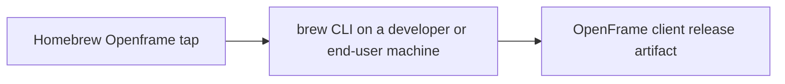

## Development Environment Setup

This guide explains how to set up a local development environment for working on **homebrew-openframe**, the Homebrew tap repository that distributes the OpenFrame client (CLI and/or cask) for macOS and Linux users via `brew`.

> **Repository role:** `flamingo-stack/homebrew-openframe` is a Homebrew tap. The repository graph currently has no indexed Formula/Cask source files for this tap and no package manifests (no `package.json`, no `pom.xml`). This document therefore focuses on the tooling and conventions used to develop and test **Homebrew taps in general**, applied to this repository. Where the graph coverage is partial, treat the absence of a detail as "not yet indexed," not as "does not exist" — always check the actual files in the repository before assuming a convention from this document is missing.

Related reading before you start:
- [Introduction](../../getting-started/introduction.md) and [Prerequisites](../../getting-started/prerequisites.md) for the broader OpenFrame project context.
- [Install the OpenFrame client with Homebrew](../../getting-started/how-to/install-the-openframe-client-with-homebrew.md) for the end-user installation flow this tap supports.
- [Install a specific OpenFrame client channel (stage or dev)](../../getting-started/how-to/install-a-specific-openframe-client-channel-stage-or-dev.md) for channel-specific installs you may need to validate during development.
- [Upgrade or uninstall the OpenFrame client cask](../../getting-started/how-to/upgrade-or-uninstall-the-openframe-client-cask.md) for lifecycle commands this tap must keep working.
- [Local Development](./local-development.md) for day-to-day workflow once your environment is ready.

---

### 1. Required Development Tools

A Homebrew tap repository is primarily Ruby DSL (Formula/Cask files) plus shell tooling used to validate and release them. Install the following before making changes:

| Tool | Purpose | Notes |
|------|---------|-------|
| Homebrew | Core package manager that consumes this tap | Install from `https://brew.sh` if not already present on macOS or Linuxbrew |
| Git | Version control, required to clone and branch the tap | Any recent version |
| Ruby | Formula/Cask DSL is Ruby; Homebrew ships its own vendored Ruby, but having a system Ruby helps with linting | Match the Ruby version bundled with your installed Homebrew (`brew --version` / `brew ruby -e 'puts RUBY_VERSION'`) |
| `brew` CLI | Used to tap, audit, install, and test formulae/casks locally | Comes with Homebrew |
| A text editor or IDE | Editing Ruby DSL files | See IDE recommendations below |

Clone the repository:

```bash
git clone https://github.com/flamingo-stack/homebrew-openframe.git
cd homebrew-openframe
```

Tap the repository locally so `brew` resolves formulae/casks from your working copy instead of (or alongside) the published tap:

```bash
brew tap flamingo-stack/openframe https://github.com/flamingo-stack/homebrew-openframe.git
```

> If you already have the tap installed from the default source, point Homebrew at your local clone instead so you can iterate without pushing every change. Check `brew --repo flamingo-stack/openframe` to find where Homebrew expects the tap directory to live, and either symlink your clone there or re-tap using a `file://` URL pointing at your local path.

#### Verifying your toolchain

```bash
brew --version
git --version
ruby --version
```

If any of these commands are missing, install Homebrew first (it will bring Git and a vendored Ruby with it), then install a system Ruby via your OS package manager if you want to run standalone Ruby linters outside of `brew`'s sandbox.

---

### 2. IDE Recommendations and Setup

Since this repository is almost entirely Ruby DSL files (Formula and Cask definitions) plus shell/CI configuration, a full IDE is optional — a capable text editor with Ruby syntax support is sufficient. Recommended options:

#### Visual Studio Code

VS Code is the most broadly supported option across the OpenFrame organization's repositories and is recommended for consistency even though this tap has no JavaScript/TypeScript code.

Setup steps:
1. Install VS Code.
2. Open the cloned `homebrew-openframe` folder as a workspace.
3. Install the extensions listed in the next section.
4. Configure the Ruby extension to use the Ruby interpreter from your system installation (or Homebrew's vendored Ruby if you prefer linting against the exact version `brew` uses).

#### RubyMine / JetBrains IDEs

If you prefer a dedicated Ruby IDE, RubyMine (or IntelliJ IDEA with the Ruby plugin) provides stronger static analysis for the Ruby DSL used in Formula/Cask files, including inline documentation for Homebrew's `Formula` and `Cask::Cask` base classes when the Homebrew gem sources are indexed.

#### Any text editor

Formula and Cask files are plain Ruby; `vim`, `neovim`, Sublime Text, or any editor with Ruby syntax highlighting will work for small edits. For anything beyond a one-line version bump, use an editor that can run `brew audit` and `brew style` from an integrated terminal so you catch issues before opening a pull request.

---

### 3. Editor Extensions and Plugins

| Extension | Editor | Purpose |
|-----------|--------|---------|
| Ruby (`rebornix.ruby` or `shopify.ruby-lsp`) | VS Code | Syntax highlighting, formatting, and language-server support for Formula/Cask Ruby DSL |
| `koichisasada.vscode-rdbg` or Ruby LSP's built-in debugger | VS Code | Step-through debugging of Ruby scripts if you add install-time logic |
| GitLens | VS Code | Blame/history view, useful when tracking down why a Formula pin or SHA was changed |
| EditorConfig for VS Code | VS Code | Keeps indentation and line endings consistent with the rest of the tap |
| Rubocop | VS Code / RubyMine | Surfaces the same style violations `brew style` enforces, inline as you type |
| YAML | VS Code | For GitHub Actions workflow files under `.github/workflows` if present in your checkout |
| Markdown All in One | VS Code | For editing documentation such as this file |

> Install only the extensions relevant to the files you are editing. A Homebrew tap does not need a full JavaScript/TypeScript or Java toolchain — keep the editor lightweight.

---

### 4. Environment Variables for Development

Homebrew itself reads several environment variables that materially change how formulae and casks behave during local development and testing. Set these in your shell profile (`~/.zshrc`, `~/.bashrc`, or equivalent) or export them ad hoc in your terminal session before running `brew` commands against this tap.

| Variable | Purpose |
|----------|---------|
| `HOMEBREW_NO_AUTO_UPDATE` | Prevents `brew` from running its own auto-update step before every command, which speeds up iterative testing against your local tap clone |
| `HOMEBREW_NO_INSTALL_CLEANUP` | Stops Homebrew from automatically removing old versions/caches, useful while repeatedly reinstalling a formula/cask you are editing |
| `HOMEBREW_DEVELOPER` | Enables developer-mode warnings and additional checks that mirror what CI enforces, surfacing problems earlier |
| `HOMEBREW_CASK_OPTS` | Lets you pass default options (for example, `--no-quarantine`) when repeatedly testing a Cask locally |
| `GITHUB_TOKEN` | Required locally if you hit GitHub API rate limits while `brew audit`/`brew livecheck` resolve release metadata for the formula/cask you are editing |

Example of a development-friendly shell session:

```bash
export HOMEBREW_DEVELOPER=1
export HOMEBREW_NO_AUTO_UPDATE=1
export HOMEBREW_NO_INSTALL_CLEANUP=1
```

> Set `$HOMEBREW_DEVELOPER` only in your interactive development shell, not in CI or in a shared machine profile, since it changes Homebrew's default error-handling behavior.

If the specific Formula or Cask file you are editing reads environment variables at install time (for example, to select a release channel such as stage or dev — see [Install a specific OpenFrame client channel](../../getting-started/how-to/install-a-specific-openframe-client-channel-stage-or-dev.md)), check that file directly for the exact variable names it expects; this document only covers the Homebrew-level variables that apply across the whole tap.

---

### 5. Validating Your Changes Locally

Before opening a pull request, run Homebrew's own linting and audit tooling against the file(s) you changed:

```bash
brew style flamingo-stack/openframe/<formula-or-cask-name>
brew audit --strict flamingo-stack/openframe/<formula-or-cask-name>
```

Then do a full install/uninstall cycle to confirm the end-to-end flow a user would experience still works:

```bash
brew install flamingo-stack/openframe/<formula-or-cask-name>
brew uninstall flamingo-stack/openframe/<formula-or-cask-name>
```

For cask upgrade/uninstall behavior specifically, cross-check against the documented user flow in [Upgrade or uninstall the OpenFrame client cask](../../getting-started/how-to/upgrade-or-uninstall-the-openframe-client-cask.md) so your local test matches what is documented for end users.

---

### 6. Where This Fits in the Broader OpenFrame System

The code graph currently shows `homebrew-openframe` with no recorded upstream dependencies and no recorded downstream consumers (coverage is partial: OpenFrame CLI and OpenFrame OSS Tenant are not indexed from this repository's perspective, so this is not proof they don't consume artifacts from this tap). In practice, this tap exists to distribute the OpenFrame client described in the getting-started guides; treat the CLI's actual release artifacts as the source of truth for version pins and checksums you edit here.



Once your environment is set up, continue with [Local Development](./local-development.md) for the day-to-day edit/test/release loop, and consult [Contributing Guidelines](../contributing/guidelines.md) before submitting a pull request.
