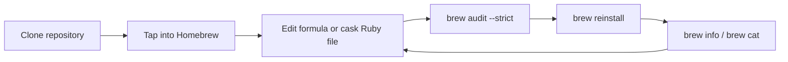

# Local Development

> **Repository role:** `flamingo-stack/homebrew-openframe` is a [Homebrew](https://brew.sh) tap. It does not contain an application, a `package.json`, or a `pom.xml` — its payload is Ruby **Formula**/**Cask** definitions that tell Homebrew how to fetch, install, and manage the OpenFrame client on a user's machine. "Local development" for this repository means working on and testing those Ruby definitions, not running a service or a frontend.

This guide explains how to clone the tap, exercise it locally against Homebrew, and iterate on formula/cask changes with the fastest feedback loop available (there is no hot-reload server and no debugger in the traditional sense — "reload" here means re-running `brew install`/`brew reinstall` against your local checkout).

> The automated repository-fact scan found no `package.json`, no `pom.xml`, no CLI bootstrap files, no shell scripts, and no Docker Compose files checked into this repository. Everything below is standard Homebrew tooling (`brew`, `git`, `ruby`) applied to a tap, not a custom build system shipped by this repo.

---

## 1. Prerequisites

Before cloning, make sure your machine has:

| Tool | Why you need it |
|------|------------------|
| macOS or Linux with [Homebrew](https://brew.sh) installed | The tap only works through the `brew` CLI |
| `git` | Cloning the tap and submitting changes |
| A text editor | Editing Ruby formula/cask files |

Check Homebrew is installed and healthy before doing anything else:

```bash
brew --version
brew doctor
```

> If this is your first time working with any OpenFrame repository, see `../../getting-started/introduction.md` and `../../getting-started/prerequisites.md` for the broader OpenFrame environment context. This document only covers the tap itself.

---

## 2. Clone and setup

### 2.1 Clone the tap repository directly (for editing)

To work on the formula/cask source, clone the repository like any other git project:

```bash
git clone https://github.com/flamingo-stack/homebrew-openframe.git
cd homebrew-openframe
```

This gives you a plain working copy you can edit with your editor of choice and inspect with `git diff` / `git status` as usual.

### 2.2 Tap it into Homebrew (for installation testing)

Editing the files alone does not make Homebrew aware of them. To exercise the formula/cask the same way an end user would, add the repository as a **tap**. Homebrew taps are themselves git clones that `brew` manages under its own directory structure, so you have two options:

**Option A — let Homebrew clone it for you:**

```bash
brew tap flamingo-stack/openframe
```

Homebrew derives the tap name `flamingo-stack/openframe` from the `homebrew-openframe` repository name (Homebrew strips the `homebrew-` prefix when forming the tap's short name). This clones the repository into Homebrew's tap directory (under `$(brew --repository)/Library/Taps/`).

**Option B — point Homebrew at your own local clone** (preferred when actively editing):

```bash
git clone https://github.com/flamingo-stack/homebrew-openframe.git \
  "$(brew --repository)/Library/Taps/flamingo-stack/homebrew-openframe"
```

With this layout, `git pull`/`git status` inside the tapped directory and inside your working clone are the same repository, so edits you make are picked up by `brew` immediately without re-tapping.

> `` `$(brew --repository)` `` resolves to your local Homebrew prefix (commonly `/opt/homebrew` on Apple Silicon or `/usr/local` on Intel Macs). Always wrap shell variables like `$(brew --repository)` in backticks when referring to them in prose, and use them unquoted only inside actual shell commands.

### 2.3 Verify the tap is registered

```bash
brew tap
```

You should see `flamingo-stack/openframe` in the list. If it is missing, repeat step 2.2.

---

## 3. Running locally

"Running" a Homebrew tap means invoking `brew` subcommands against the formula/cask files it contains — there is no server process to start.

### 3.1 Install from your local tap

Once tapped, install the package the same way a consumer of the tap would, but Homebrew will resolve the formula/cask from your local (possibly modified) files:

```bash
brew install flamingo-stack/openframe/<formula-or-cask-name>
```

Replace `<formula-or-cask-name>` with the actual name defined inside the tap (check the file name under the tap's `Formula/` or `Casks/` directory — Homebrew formula/cask names match their file names without the `.rb` extension).

### 3.2 Audit the formula/cask before installing

Always run Homebrew's built-in linter against a definition before testing an install. This catches style and structural issues the same way Homebrew's own CI would:

```bash
brew audit --strict flamingo-stack/openframe/<formula-or-cask-name>
```

For a cask specifically, you can also run cask-specific style checks:

```bash
brew style flamingo-stack/openframe
```

### 3.3 Verify an installed cask/formula

After installation, confirm it behaves as expected:

```bash
brew info flamingo-stack/openframe/<formula-or-cask-name>
```

This prints the resolved version, install path, and caveats defined in the Ruby source — useful for confirming your local edit took effect rather than a previously cached definition.

### 3.4 Related install guides

For end-user-facing installation flows that this tap supports (which you can use to validate your changes end-to-end), see:

- `../../getting-started/how-to/install-the-openframe-client-with-homebrew.md`
- `../../getting-started/how-to/install-a-specific-openframe-client-channel-stage-or-dev.md`
- `../../getting-started/how-to/upgrade-or-uninstall-the-openframe-client-cask.md`

---

## 4. Hot reload / watch mode

Homebrew taps have no build step and no watcher process — there is nothing to compile and nothing that serves live output, so there is no "hot reload" in the frontend/backend sense. Instead, the fast local iteration loop is:

1. Edit the formula/cask `.rb` file in your clone.
2. If you used the **tapped-clone** approach from section 2.2 (editing directly inside `$(brew --repository)/Library/Taps/flamingo-stack/homebrew-openframe`), Homebrew reads your changes immediately — there is no cache to clear.
3. Re-run the install to pick up the change:

```bash
brew reinstall flamingo-stack/openframe/<formula-or-cask-name>
```

4. Re-run the audit after every edit, since most mistakes in Ruby DSL formulas/casks are caught statically rather than at install time:

```bash
brew audit --strict flamingo-stack/openframe/<formula-or-cask-name>
```

> If you edited your **separate** working clone (section 2.1) instead of the tapped directory, remember to `git pull`/sync or re-run `brew tap` so Homebrew's tapped copy reflects your latest edit — otherwise `brew reinstall` will silently use stale content.

### 4.1 Forcing Homebrew to bypass its cache

Homebrew caches downloaded artifacts referenced by a formula/cask's `url`/`sha256`. When testing a version bump or a URL change, clear the relevant cache entry so you are testing the real download path, not a stale local copy:

```bash
brew uninstall flamingo-stack/openframe/<formula-or-cask-name>
brew cleanup -s flamingo-stack/openframe/<formula-or-cask-name>
brew install flamingo-stack/openframe/<formula-or-cask-name>
```

---

## 5. Debug configuration

There is no debugger attachable to a Homebrew tap in the IDE sense (no running process, no breakpoints). "Debugging" here means increasing `brew`'s own verbosity and inspecting what the Ruby DSL resolves to.

### 5.1 Verbose and debug install output

Homebrew's CLI has built-in flags for tracing what it is doing during an install:

```bash
brew install --verbose --debug flamingo-stack/openframe/<formula-or-cask-name>
```

- `--verbose` prints each shell command Homebrew executes.
- `--debug` drops into an interactive debugger shell at each major install phase (download, patch, install), letting you inspect intermediate state before continuing.

### 5.2 Dry-run / inspect resolution without installing

To see how Homebrew resolves a formula/cask (version, URL, checksum, dependencies) without actually installing anything:

```bash
brew info flamingo-stack/openframe/<formula-or-cask-name>
brew cat flamingo-stack/openframe/<formula-or-cask-name>
```

`brew cat` prints the exact Ruby source Homebrew is currently reading for that definition — useful to confirm you are not looking at a cached/stale formula from a different tap.

### 5.3 Linting as your primary "debugger"

Because formulas/casks are declarative Ruby DSL rather than imperative application code, most "bugs" are caught by Homebrew's own linter rather than at runtime. Treat `brew audit --strict` and `brew style` (section 3.2) as your first line of debugging before attempting an actual install.

### 5.4 Checking install logs after a failure

If `brew install` fails, Homebrew prints the path to its log directory in the failure output. Re-run with `--verbose --debug` as shown above to get the full command trace inline, which is almost always enough to diagnose tap issues (bad URL, checksum mismatch, missing dependency) without needing external logs.

---

## 6. Summary of the local iteration loop



Because this repository has no application server, no package manager manifest, and no CI-detected build tooling, the entire "local development" surface area is: edit Ruby, lint with `brew audit`/`brew style`, and reinstall with `brew reinstall` to confirm behavior — repeating until `brew audit --strict` is clean and the install/upgrade/uninstall flow behaves as documented in the how-to guides linked above.

For broader environment setup shared across OpenFrame repositories, see `./environment.md`. For the general development workflow and contribution expectations, see `../README.md` and `../contributing/guidelines.md`.
