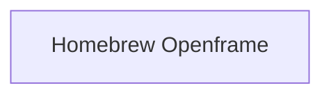

## Testing

> Homebrew Openframe (`flamingo-stack/homebrew-openframe`) is a Homebrew tap: a thin repository of Ruby Cask/Formula definitions that `brew` reads to install the OpenFrame client. It carries no application source code, no `package.json`, no `pom.xml`, and the repository graph records no build manifest and no consumers or dependencies of its own (see the Ecosystem section below). "Testing" here means validating the tap's Ruby definitions and the install flow they drive, not running a unit-test suite against application logic.

### How this repository fits the wider system

The organization's code graph has only partial coverage of this repository and reports:

- No artifact published by this repository that another repository pins.
- No repository recorded as a consumer of this one.
- Three related repositories (OpenFrame CLI, OpenFrame OSS Tenant, and one repository not visible from here) are not indexed, so their absence from the consumer list is not evidence they don't use this tap — it only means no fresh graph exists for them.



In practice, this tap exists to let a user run `brew install` (via a Cask or Formula) to get the OpenFrame client onto their machine. Because the repository holds no source code, automated unit tests in the traditional sense (Jest, JUnit, pytest, cargo test) do not apply here. "Testing" for a Homebrew tap instead means:

- Linting and auditing the Ruby Cask/Formula files with Homebrew's own tooling.
- Running a real (or `--dry-run`) install against the definitions to confirm the cask resolves, downloads, and installs correctly.
- Verifying upgrade and uninstall paths work as expected.

> If your task also touches the OpenFrame client binary or the OpenFrame CLI that this tap installs, their own test suites live in their respective repositories (OpenFrame CLI, OpenFrame OSS Tenant) — this document only covers what can be verified from within `flamingo-stack/homebrew-openframe`.

---

### Test structure and organization

This repository does not have a `test/` or `spec/` directory of its own code — it has no application code to unit test. Instead, "tests" are the validations Homebrew provides out of the box for any tap:

| Validation | What it checks | Tool |
|---|---|---|
| Style / lint | Ruby syntax, Homebrew style conventions (quoting, ordering of stanzas, deprecated DSL usage) | `brew style` |
| Audit | Cask/Formula correctness — valid `url`, `sha256`, `version`, naming conventions, livecheck configuration | `brew audit` |
| Install smoke test | The cask actually downloads and installs the artifact it points to | `brew install --cask` (or `brew install` for a Formula), optionally with `--dry-run` or `--verbose` |
| Uninstall / upgrade smoke test | The cask's `uninstall`/`zap` stanzas (if present) clean up correctly, and upgrading from an older version to a newer one succeeds | `brew upgrade --cask`, `brew uninstall --cask`, `brew reinstall --cask` |

These checks are the de-facto "test suite" for this repository: there is no custom test runner, CI test framework, or coverage tool configured in the material available for this tap.

#### Where to look for the definitions being validated

The tap's Cask and/or Formula files are what every check above operates on. When adding or changing one, confirm you are editing the Ruby file under the tap's standard Homebrew layout (a `Casks/` directory for cask definitions, `Formula/` for formula definitions) rather than a copy or a generated artifact. Treat the installable artifacts referenced by the cask — the OpenFrame client build it points at — as external inputs you do not modify from this repository.

---

### Running tests

Because this is a tap, "running tests" means running Homebrew's own validation commands against your local checkout, not invoking a project-specific script.

#### 1. Tap your local checkout

Point Homebrew at your working copy so `brew` commands resolve against the file you are editing rather than the published tap:

```bash
git clone https://github.com/flamingo-stack/homebrew-openframe.git
brew tap --force-auto-update flamingo-stack/openframe "$(pwd)/homebrew-openframe"
```

> Homebrew taps are conventionally named `<owner>/<name>` with the `homebrew-` prefix stripped, so a clone of `homebrew-openframe` is tapped as `flamingo-stack/openframe`.

#### 2. Style and lint

Run Homebrew's style checker against the changed file before anything else — it catches most formatting issues a reviewer would otherwise flag:

```bash
brew style flamingo-stack/openframe
```

#### 3. Audit

`brew audit` performs deeper correctness checks (URL reachability conventions, checksum presence, version/format conventions, and cask-specific rules such as `livecheck` blocks and artifact stanzas):

```bash
brew audit --cask flamingo-stack/openframe/<cask-name>
```

Replace `<cask-name>` with the actual token defined in the cask file you are validating (for example, the token used to install the OpenFrame client, as covered in the Getting Started installation guides).

#### 4. Install smoke test

The most meaningful "test" for a tap is a real install. Run it locally before opening a pull request:

```bash
brew install --cask flamingo-stack/openframe/<cask-name>
```

To verify behavior without actually downloading and installing (useful when iterating on metadata only), use `--dry-run`:

```bash
brew install --cask --dry-run flamingo-stack/openframe/<cask-name>
```

#### 5. Upgrade and uninstall paths

If your change touches versioning, `livecheck`, or `uninstall`/`zap` stanzas, also verify the upgrade and removal paths:

```bash
brew upgrade --cask flamingo-stack/openframe/<cask-name>
brew uninstall --cask flamingo-stack/openframe/<cask-name>
```

These map directly to the day-to-day flows a user of this tap goes through, documented from the consumer's perspective in the install and upgrade/uninstall how-to guides.

#### 6. Clean up your local tap

Once done, untap your local checkout to avoid it shadowing the published tap in future `brew` operations:

```bash
brew untap flamingo-stack/openframe
```

> There is no CI workflow file in this repository dedicated to running these checks automatically on every push to source files (the workflows present, `.github/workflows/code-documentation.yml` and `.github/workflows/flamingo-code-review.yml`, drive the documentation pipeline and the automated code review bot — they are not a test runner for the Cask/Formula definitions). Run the commands above locally before opening a pull request.

---

### Writing new tests

"Writing a test" in this repository means writing (or updating) the Cask/Formula definition so that it passes `brew style` and `brew audit`, and verifying it with a real install — there is no test file format to author.

When you add a new cask or formula, or modify an existing one, go through this checklist:

1. **Syntax and style** — run `brew style` against the file and fix any reported violations before moving on.
2. **Required stanzas** — make sure the definition has the fields `brew audit` expects: a `version`, a `sha256` (or equivalent checksum mechanism), a `url`, and, for casks, the correct `app`/`pkg`/`binary` artifact stanza for how the OpenFrame client is packaged.
3. **Naming** — the cask/formula token must match Homebrew's naming conventions (lowercase, hyphenated) so it resolves the way the install how-to guides describe.
4. **Livecheck** — if the cask tracks upstream releases, confirm or add a `livecheck` block so future version bumps can be audited automatically.
5. **Install verification** — actually install it locally (`brew install --cask ...`) and confirm the OpenFrame client lands where expected and launches/functions as documented.
6. **Channel variants** — if your change affects how a specific release channel (stage, dev, or a pinned version) is selected, verify each supported channel installs correctly, matching the scenarios described in the "install a specific channel" how-to guide.
7. **Upgrade/uninstall** — if you touched version pinning or cleanup stanzas, run the upgrade and uninstall commands above to confirm they still behave correctly end to end.

Before submitting, double-check your change is scoped to the Cask/Formula definitions under this tap — do not try to vendor or duplicate the OpenFrame client's own source or build artifacts into this repository; those belong to their owning repositories and are referenced by this tap via `url`/checksum only.

> Code owned by the DevOps engineers team governs this repository (see `.github/CODEOWNERS`): any pull request against the tap's files is reviewed under that ownership, so keep changes narrowly scoped to the Cask/Formula definitions and their supporting metadata.

---

### Coverage requirements

There is no code-coverage tool, coverage threshold, or coverage report configured for this repository — the repository graph recorded no manifest, no test framework, and no coverage configuration (`"verified": true` with empty `frontend`, `backend`, and `setup` sections). Treat "coverage" here as **scenario coverage** instead of statement/line coverage:

| Scenario | Must be verified before merging |
|---|---|
| Fresh install | `brew install --cask` succeeds for every cask token changed or added |
| Upgrade from a previous version | `brew upgrade --cask` succeeds when the cask's version/checksum changes |
| Uninstall / zap | `brew uninstall --cask` removes the installed artifact cleanly |
| Every supported channel | Each release channel the cask exposes (stable, stage, dev) installs correctly |
| Style and audit | `brew style` and `brew audit` both report no violations |

A change that only edits a version bump or checksum should, at minimum, be run through `brew style`, `brew audit`, and a real `brew install --cask` against the new definition before it is merged. A change that adds a new cask/formula, or alters artifact/uninstall stanzas, should additionally go through the upgrade and uninstall scenarios above.

Because the automated review workflow in this repository (`flamingo-code-review.yml`) performs code review rather than functional testing, it does not substitute for the manual `brew style` / `brew audit` / install verification described above — run those commands yourself as part of your local workflow before requesting review.
