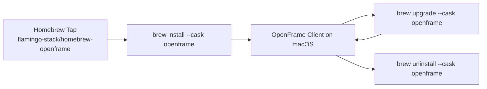

## First Steps

This page walks you through what to do right after you've installed the OpenFrame client using the `homebrew-openframe` Homebrew tap. It assumes you have already completed the installation described in the [Quick Start](./quick-start.md) guide, with the [Prerequisites](./prerequisites.md) satisfied. If you haven't installed anything yet, start there before continuing here.

This repository is a **Homebrew tap**: a Git repository that holds the Homebrew cask/formula definitions Homebrew uses to install, upgrade, and uninstall the OpenFrame client on macOS. It does not contain application source code, a frontend, or a backend service — its job is to tell `brew` where to fetch the OpenFrame client and how to manage it on your system. Keep that in mind as you read the rest of this guide: "configuration" here mostly means choosing the right Homebrew tap/cask/channel, not editing an app config file.

> **Note**
> Because this is a Homebrew tap rather than a running application, there is no admin UI, API, or dashboard shipped from this repository itself. Once the client is installed, its ongoing behavior and any in-app configuration are governed by the OpenFrame client itself, not by this tap.

---

### 1. First 5 things to do after installation

Once `brew install` has completed successfully, work through these five checks before you rely on the client day to day.

#### 1. Confirm the cask installed correctly

Run Homebrew's info command against the cask to confirm the version and install path Homebrew recorded:

```bash
brew info --cask openframe
```

If the command returns cask details (version, install location, caveats) rather than an error, the tap was added and the cask resolved correctly.

#### 2. Verify you're tracking the tap you expect

Homebrew taps can be added more than once or from a wrong source by mistake. List the taps you have registered to confirm `flamingo-stack/homebrew-openframe` (or its configured tap name) is present:

```bash
brew tap
```

#### 3. Decide which release channel you need

The OpenFrame client can be installed from different channels (for example, a stable channel versus stage or dev channels used for pre-release testing). Before you integrate the client into daily workflows, confirm you installed the channel appropriate for your use case. If you are not sure which channel you used, or need a non-default one, follow [Install a specific OpenFrame Client channel (stage or dev)](./how-to/install-a-specific-openframe-client-channel-stage-or-dev.md).

#### 4. Check the installed client's version and location

Confirm the binary Homebrew linked is the one your shell resolves:

```bash
which openframe
openframe --version
```

If `which` does not resolve or you see a "command not found" error, revisit the installation steps in [Install the OpenFrame Client with Homebrew](./how-to/install-the-openframe-client-with-homebrew.md) before continuing — a missing shell link is the most common first-run issue.

#### 5. Note how you will keep the client up to date

Decide now whether you'll update manually or as part of a routine `brew upgrade` pass across your machine. Review [Upgrade or uninstall the OpenFrame Client cask](./how-to/upgrade-or-uninstall-the-openframe-client-cask.md) so you know the exact commands before you need them, rather than discovering them during an incident.

---

### 2. Common initial configuration

Because this repository only defines how Homebrew fetches and manages the client, "configuration" at this layer is limited to a few tap- and cask-level choices rather than application settings:

| Configuration point | What it controls | Where to act |
|---|---|---|
| Which tap is registered | Which repository Homebrew pulls cask definitions from | `brew tap` / `brew untap` |
| Which channel/cask variant is installed | Stable vs. stage vs. dev builds of the client | See the channel how-to guide below |
| Cask install vs. upgrade vs. removal | Lifecycle of the client binary on your Mac | See the upgrade/uninstall how-to guide below |

If you need to switch channels later (for example, moving from a dev build to stable, or vice versa), do not simply reinstall on top of the existing cask — follow the channel-switching steps in [Install a specific OpenFrame Client channel (stage or dev)](./how-to/install-a-specific-openframe-client-channel-stage-or-dev.md) to avoid leaving a stale cask reference behind.

Any further configuration — authentication, device enrollment, connecting the client to an OpenFrame server, UI preferences, and so on — belongs to the OpenFrame client application itself, not to this Homebrew tap. Consult your OpenFrame deployment's own configuration surface for those settings; this tap's scope ends at "the binary is installed and up to date on your machine."

---

### 3. Exploring key features

Since this repository's only surface area is the Homebrew packaging layer, the "features" worth exploring here are the Homebrew-level operations it enables:

- **Installing the client** — the baseline flow covered in [Install the OpenFrame Client with Homebrew](./how-to/install-the-openframe-client-with-homebrew.md). Revisit this if you ever need to install OpenFrame on an additional Mac.
- **Installing a non-default channel** — useful if you're validating a pre-release build or need a stage/dev build for testing. See [Install a specific OpenFrame Client channel (stage or dev)](./how-to/install-a-specific-openframe-client-channel-stage-or-dev.md).
- **Upgrading in place** — pulling a newer cask definition and relinking the binary without a full reinstall. See [Upgrade or uninstall the OpenFrame Client cask](./how-to/upgrade-or-uninstall-the-openframe-client-cask.md).
- **Clean removal** — the same upgrade/uninstall guide also covers fully removing the cask if you need to decommission a machine or start over with a different channel.



Once the client itself is installed and running, its day-to-day features (enrollment, monitoring, management workflows, and so on) are part of the OpenFrame client application and its connected OpenFrame server — not something this tap repository configures or exposes. Treat this tap purely as the install/upgrade/uninstall mechanism, and look to your OpenFrame client and server documentation for everything after the binary lands on disk.

---

### 4. Where to get help

If something in the install, upgrade, or channel-selection flow doesn't behave as expected:

1. **Re-check the relevant how-to guide first.** Each of the three linked guides in this document walks through the exact `brew` commands for its scenario — most issues (wrong channel, stale tap, failed upgrade) are resolved by re-running the correct sequence from the matching guide rather than improvising new commands.
2. **Confirm prerequisites.** Revisit [Prerequisites](./prerequisites.md) to confirm your macOS version, Homebrew installation, and any other requirements are met — a surprising number of install failures trace back to an outdated Homebrew install rather than the tap itself.
3. **Re-run Quick Start from scratch.** If you're unsure what state your installation is in, the [Quick Start](./quick-start.md) guide is safe to work through again end-to-end.
4. **File an issue.** If you've confirmed the prerequisites and followed the relevant how-to guide and still hit a problem, open an issue against this tap repository at [https://github.com/flamingo-stack/homebrew-openframe/issues](https://github.com/flamingo-stack/homebrew-openframe/issues). Include the output of `brew info --cask openframe`, `brew tap`, and the exact command you ran.
5. **Check open pull requests** at [https://github.com/flamingo-stack/homebrew-openframe/pulls](https://github.com/flamingo-stack/homebrew-openframe/pulls) if you suspect a fix or channel update is already in progress.

If your question is about the OpenFrame client's runtime behavior rather than its installation via Homebrew (for example, enrollment, connectivity to an OpenFrame server, or in-app features), that falls outside this tap's scope — consult the documentation and support channels for the OpenFrame client and server themselves.

---

### Where this leaves you

At this point you should have confirmed the cask is installed, know which channel you're on, can find the version and location of the binary, and know where to go for upgrades, uninstalls, or help. From here, the natural next step for most readers is simply using the installed OpenFrame client day to day; if you later need to change channels or remove the client, the two how-to guides referenced above cover those flows in full.
