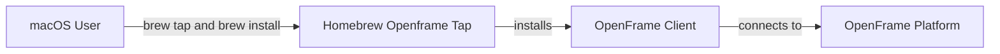

## What is Homebrew Openframe?

Homebrew Openframe (`flamingo-stack/homebrew-openframe`) is the official [Homebrew](https://brew.sh) tap for the **OpenFrame Client**, part of the Flamingo AI OpenFrame platform. A Homebrew tap is a repository of formulas and casks that extends what `brew` can install beyond Homebrew's default collection. This tap exists for one purpose: to let macOS users install, upgrade, and manage the OpenFrame Client with the same `brew` commands they already use for every other tool on their machine.

Rather than shipping a custom installer or asking users to download binaries by hand, the OpenFrame team publishes install definitions here so that `brew tap flamingo-stack/openframe` followed by a `brew install` (or `brew install --cask`, depending on how the client is packaged) is enough to get a working OpenFrame Client on a developer's or an end user's machine.

## Key features and benefits

- **Single command install** — adds the OpenFrame Client to the standard Homebrew workflow, so there is no bespoke installer to learn.
- **Versioned channels** — supports installing specific release channels (stable, stage, or dev), letting teams pick the maturity level that fits their needs. See [Install a specific OpenFrame Client channel](./how-to/install-a-specific-openframe-client-channel-stage-or-dev.md).
- **Straightforward upgrades and removal** — the client can be upgraded or uninstalled using familiar Homebrew cask commands. See [Upgrade or uninstall the OpenFrame Client cask](./how-to/upgrade-or-uninstall-the-openframe-client-cask.md).
- **Consistent with macOS tooling conventions** — fits naturally alongside other developer and IT tooling already managed through Homebrew.

## Target audience

This tap is intended for:

- **macOS users and IT administrators** who need to install or roll out the OpenFrame Client on one or more Macs.
- **Developers and operators working with OpenFrame** who want a fast, repeatable way to get the client onto a workstation without manual downloads.
- **Teams evaluating pre-release builds** who need access to stage or dev channels before a stable release.

A working Homebrew installation on macOS is the only prerequisite assumed before using this tap; see [Prerequisites](./prerequisites.md) for details before you begin.

## How it fits into OpenFrame

This repository's role is narrow and specific: it is a Homebrew tap, not an application or library with its own runtime dependencies. It does not publish a Maven, npm, or other package artifact, and the repository graph records no upstream dependencies and no downstream consumers for it — its "consumers" are end-user machines running `brew`, not other repositories in the OpenFrame codebase. The actual OpenFrame Client binary and the broader OpenFrame platform (including the OpenFrame CLI and the OpenFrame OSS Tenant) live in other repositories; this tap simply tells Homebrew where to find and how to install that client.

## Getting started

To go from zero to a running OpenFrame Client on macOS, follow the getting-started path in order:

1. [Prerequisites](./prerequisites.md) — what you need before installing (notably, Homebrew itself).
2. [Quick start](./quick-start.md) — the fastest path to an installed OpenFrame Client.
3. [First steps](./first-steps.md) — what to do once the client is installed.
4. [Install the OpenFrame Client with Homebrew](./how-to/install-the-openframe-client-with-homebrew.md) — the core how-to for a standard install.
5. [Install a specific OpenFrame Client channel (stage or dev)](./how-to/install-a-specific-openframe-client-channel-stage-or-dev.md) — for pre-release or testing scenarios.
6. [Upgrade or uninstall the OpenFrame Client cask](./how-to/upgrade-or-uninstall-the-openframe-client-cask.md) — ongoing maintenance of an existing install.

If you intend to contribute to this tap or work on it locally, see the [development environment setup](../development/setup/environment.md), [local development guide](../development/setup/local-development.md), the [development overview](../development/README.md), [security practices](../development/security/README.md), [testing guidance](../development/testing/README.md), and the [contribution guidelines](../development/contributing/guidelines.md).

> **Note:** This repository's role in the wider Flamingo ecosystem graph is currently recorded as unknown, and coverage of related repositories (including the OpenFrame CLI and OpenFrame OSS Tenant) is partial. An absence of recorded consumers here does not mean the tap is unused — it reflects what the current index has indexed, not the full picture of how OpenFrame users consume it.

## License

This repository is licensed under **The Flamingo AI Unified License v1.0**, copyright Flamingo AI, Inc. The license covers all Flamingo AI products, including OpenFrame, and is also the Terms of Use. It permits use, copying, modification, and distribution of Flamingo Software, including self-hosting, subject to copyleft and contribution-back obligations, but it restricts offering the software as a competing commercial managed service without a separate commercial license from Flamingo AI. Some OpenFrame components incorporate upstream software (Fleet, Osquery, MeshCentral Agent) that remain under their own original licenses as listed in the license's Appendix. See the full text in `LICENSE.md` for complete terms.
