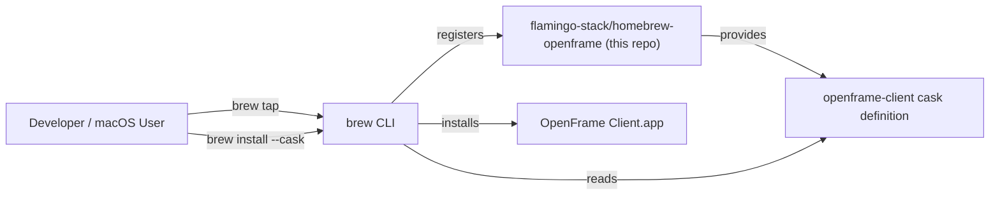

## Quick Start

`homebrew-openframe` is the [Homebrew](https://brew.sh) tap that distributes the **OpenFrame Client** as a Homebrew cask, so macOS users can install, upgrade, and uninstall the OpenFrame Client with a few `brew` commands instead of a manual download.

This page gets you from zero to a running OpenFrame Client install in under 5 minutes.

> **Note:** This repository is a Homebrew tap (a package-definition repository). It does not ship its own application code, server, or library — it points Homebrew at the OpenFrame Client cask definition so `brew` can fetch and install it. The actual OpenFrame Client application lives in a separate repository (OpenFrame CLI), which is outside the scope of this tap.

---

### Prerequisites

- **macOS** with [Homebrew](https://brew.sh) installed.
- A terminal (`Terminal.app`, `iTerm2`, etc.).

If you don't have Homebrew yet, install it first by following the instructions at [https://brew.sh](https://brew.sh), then come back here.

For a more complete environment checklist, see [Prerequisites](./prerequisites.md).

---

### TL;DR: 5-Minute Setup

Tap this repository and install the OpenFrame Client cask:

```bash
# 1. Add the flamingo-stack OpenFrame tap
brew tap flamingo-stack/openframe

# 2. Install the OpenFrame Client
brew install --cask openframe-client

# 3. Verify the tap is registered
brew tap-info flamingo-stack/openframe
```

That's it — Homebrew resolves the cask from this tap, downloads the OpenFrame Client, and installs it like any other macOS application.

> For the full, step-by-step walkthrough (including channel selection and verification steps), see [Install the OpenFrame Client with Homebrew](./how-to/install-the-openframe-client-with-homebrew.md).

---

### "Hello World": Your First Install

Think of this tap the same way you'd think of any Homebrew formula/cask repository: tapping it registers the repository as a source of installable packages, and `install` pulls down the actual software.

```bash
# Tap the repository
brew tap flamingo-stack/openframe

# List what the tap provides (sanity check)
brew search openframe

# Install the default (stable) OpenFrame Client build
brew install --cask openframe-client
```

Once installed, confirm the app is present:

```bash
# Confirm the cask is installed
brew list --cask | grep openframe-client

# Open the installed application
open -a "OpenFrame Client"
```

#### Expected Output

A successful tap and install looks like this:

```text
==> Tapping flamingo-stack/openframe
Cloning into '/opt/homebrew/Library/Taps/flamingo-stack/homebrew-openframe'...
Tapped 1 cask (XX files, XXX.XKB).

==> Downloading OpenFrame Client
==> Installing Cask openframe-client
==> Moving App 'OpenFrame Client.app' to '/Applications/OpenFrame Client.app'
🍺  openframe-client was successfully installed!
```

Running `brew list --cask` afterward should show `openframe-client` in the list of installed casks, and `/Applications/OpenFrame Client.app` should exist on disk.

> If `brew search openframe` returns nothing, double-check the tap name was typed exactly as `flamingo-stack/openframe` and that `brew tap-info flamingo-stack/openframe` reports it as installed.

---

### Installing a Specific Channel (Optional)

OpenFrame Client builds may be published under different channels (for example, a stable channel versus pre-release channels such as stage or dev). If you need something other than the default stable build — to test an upcoming release, for instance — follow [Install a specific OpenFrame Client channel (stage or dev)](./how-to/install-a-specific-openframe-client-channel-stage-or-dev.md) instead of the default `brew install --cask openframe-client` command above.

---

### Upgrading and Uninstalling

Homebrew casks are upgraded and removed the same way as any other cask:

```bash
# Upgrade to the latest version published on your tapped channel
brew upgrade --cask openframe-client

# Uninstall the OpenFrame Client
brew uninstall --cask openframe-client

# Remove the tap entirely (optional cleanup)
brew untap flamingo-stack/openframe
```

Full details, including what to do if an upgrade seems stuck or you need to switch channels, are in [Upgrade or uninstall the OpenFrame Client cask](./how-to/upgrade-or-uninstall-the-openframe-client-cask.md).

---

### How This Fits Together



This repository's only job is to hold the cask definition that `brew` reads. The actual OpenFrame Client application binary and its runtime behavior are maintained in the OpenFrame CLI repository; this tap simply tells Homebrew where to fetch it.

> Index coverage for this repository's ecosystem graph is partial: OpenFrame CLI and OpenFrame OSS Tenant are not currently indexed, so no consumer relationships are recorded here. Absence of a recorded consumer does not mean nothing depends on this tap — it only means the graph has no fresh snapshot for those repositories yet.

---

### Troubleshooting Quick Checks

| Symptom | Check |
|---|---|
| `brew tap flamingo-stack/openframe` fails | Confirm Homebrew itself is installed and up to date (`brew --version`, `brew update`). |
| `brew search openframe` shows nothing after tapping | Re-run `brew tap-info flamingo-stack/openframe` to confirm the tap is registered. |
| `brew install --cask openframe-client` fails to find the cask | Verify the tap name is exactly `flamingo-stack/openframe` (no typos, correct case). |
| App doesn't appear in `/Applications` | Re-run `brew list --cask` to confirm the cask reports as installed, then retry `brew reinstall --cask openframe-client`. |

---

### Next Steps

- Walk through the detailed installation flow in [Install the OpenFrame Client with Homebrew](./how-to/install-the-openframe-client-with-homebrew.md).
- If you need a non-default build, read [Install a specific OpenFrame Client channel (stage or dev)](./how-to/install-a-specific-openframe-client-channel-stage-or-dev.md).
- When it's time to update or remove the client, see [Upgrade or uninstall the OpenFrame Client cask](./how-to/upgrade-or-uninstall-the-openframe-client-cask.md).
- For background on the broader OpenFrame project this tap serves, read [Introduction](./introduction.md).
- Before you start, make sure your machine matches [Prerequisites](./prerequisites.md).
- Once installed, continue to [First Steps](./first-steps.md) to start using the OpenFrame Client.
